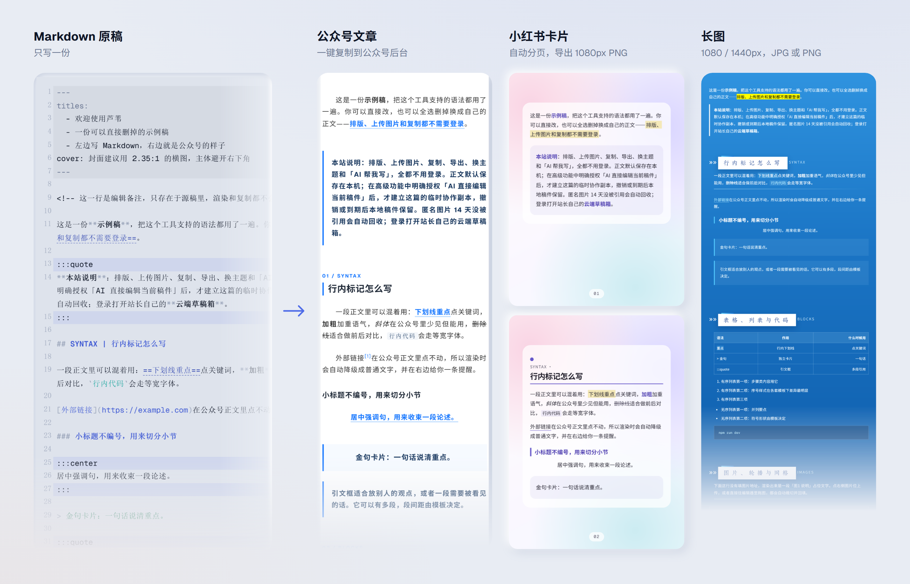
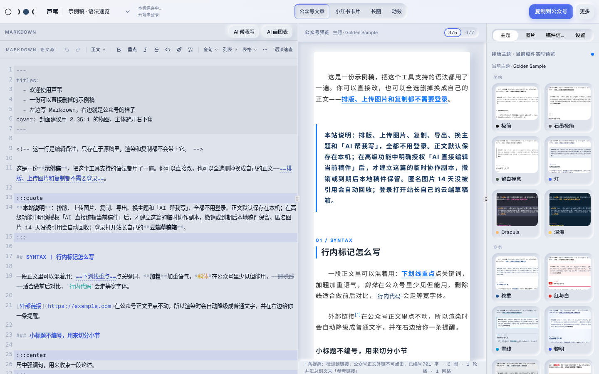
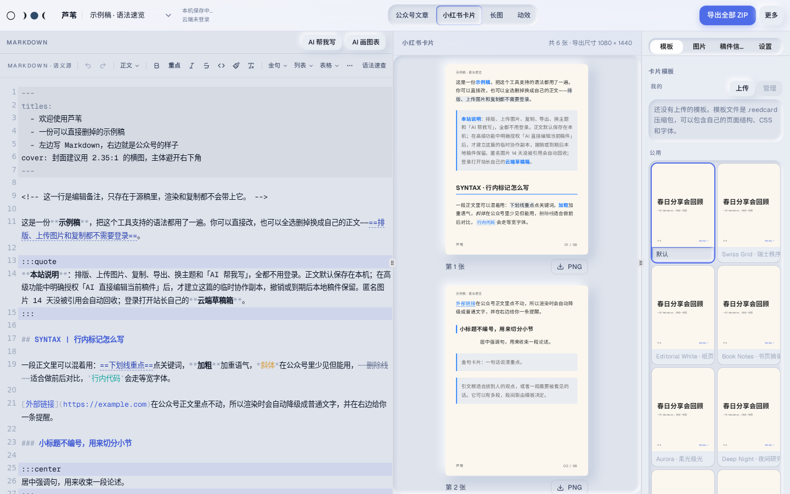
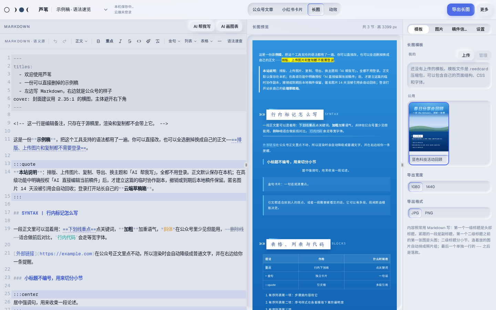
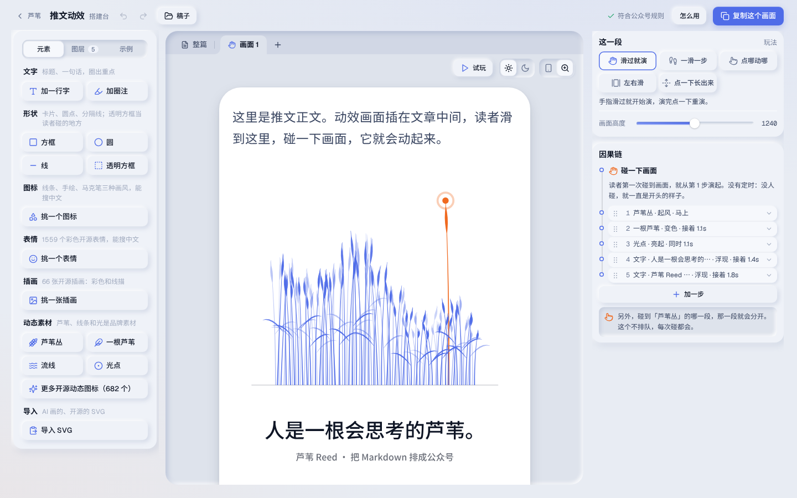

[中文](README.md) | [English](README_EN.md)

# 芦苇 · Reed

> 人是一根会思考的芦苇。

**一份 Markdown，排出公众号文章、小红书卡片和长图。**

芦苇是免费、开源的网页排版工具，打开就能用，不用安装，也不用注册登录。同一个工作台里还能做能滑、能点的公众号交互动效，或者让 AI 直接修改你正在写的那篇稿子。

**[在线使用芦苇](https://wechat.yoru-and-akari.dev)** · [浏览主题库](https://wechat.yoru-and-akari.dev/themes) · [AI 写作 Skill](https://wechat.yoru-and-akari.dev/skill.md)

**⭐ 觉得芦苇有用，请点右上角的 Star，让更多做内容的人找到它。**



## 为什么用芦苇

- **打开就能用。** 免费、开源，不注册、不开会员，主题和模板都能直接用。
- **一份稿子，三种成品。** 公众号文章、小红书卡片和长图共用同一份 Markdown，在顶栏切换就重新排版，改一处，三种成品一起更新。
- **复制进公众号不乱。** 输出的是微信编辑器认得的全内联 HTML；<!-- gen:theme-count -->227 套<!-- /gen:theme-count -->主题逐套按微信规则检查过，每套都标明作者、来源和许可证。
- **AI 能直接改你正在写的这篇。** 用 Remote MCP 把当前稿件授权给 Claude Code、OpenCode 等 AI 工具，它改完，浏览器里实时同步；不登录也能用。

## 四种模式

| 公众号文章 | 小红书卡片 |
|:--:|:--:|
|  |  |
| 边写边看排版效果；主题能拿当前文章试排，最多三套并排比较；一键复制到公众号后台 | 自动分页、生成封面；换模板、画幅、配色和字体，导出 1080px PNG 或整套 ZIP |
| **长图** | **推文动效** |
|  |  |
| 标题、头图、章节和照片组排成一张竖长图，连着的照片自动等高成行；导出 1080 / 1440px 的 JPG 或 PNG | 在画布上摆文字、图标、表情和插画，设定读者滑动、点击之后谁先动；五种玩法，整篇复制进公众号 |

卡片和长图模板都能上传自己做的 `.reedcard` 文件。全部功能见 [功能清单](docs/features.md)。

## 为什么做芦苇

我的工作里经常要排公众号，同一篇内容往往还要改成小红书卡片、做成活动长图。用过的排版工具，要么得登录、开会员才能用好看的模板，要么不支持 Markdown；一篇稿子要在好几个工具里重排好几遍，复制进公众号后台格式还会乱，只能一处处手动修。

有了 AI 帮忙写稿以后，这件事更别扭了：稿子几秒钟就写好，排版还得我自己一点点搬。

所以我做了芦苇：稿子只写一份，三种成品一起出，AI 也能直接参与进来。它是我每天都在用的工具，也是在真实的创作里一点点改出来的。

—— Yoru

## 和 AI 一起创作

- **让 AI 起稿。** 点编辑器里的「AI 帮我写」，把提示词或 [写作 Skill](skills/wechat-typesetter/SKILL.md) 交给 ChatGPT、Claude、Codex 等常用 AI，生成的 Markdown 粘回芦苇继续精修。
- **让 AI 画图表。** 点「AI 画图表」，把提示词和 [diagram-design-zh](https://github.com/patrick-xin/diagram-design-zh) Skill 交给你的 AI，拿到 PNG 后插入文章（中文适配作者 patrick-xin，MIT；基于 Cathryn Lavery 的 [英文原版](https://github.com/cathrynlavery/diagram-design)）。
- **让 AI 直接改当前稿件。** 在「设置 → 高级功能 → AI 直接编辑当前稿件」创建 Remote MCP 连接，授权只限这一篇。AI 读写正文，浏览器实时同步，遇到版本冲突会停下来让你选。[接入说明](docs/remote-mcp.md)

## Markdown 语法速览

常规的标题、列表、行内标记、代码块和 GFM 表格都支持。公众号扩展语法如下：

| 语法 | 效果 |
|---|---|
| `==重点==` | 关键词标记 |
| `## KICKER \| 标题` | 自动编号章节，可带短标签 |
| `> 金句` | 金句卡片 |
| `:::quote` / `:::center` … `:::` | 引文框 / 居中强调句 |
| `` | 图片与自动图号；空 `src` 留上传占位 |
| `` | 引用已上传的本站图片；公开 HTTPS 图片地址也可使用 |
| `:::carousel 4:3 标题` … `:::` | 同比例轮播，默认 `4:3` |
| `:::gallery 3 1:1 标题` … `:::` | 多图网格，默认两列正方形 |
| `$$ … $$` 独占一段 | 块级公式，转为 SVG；不支持行内公式 |
| 围栏代码语言为 `mermaid`，可附图注 | 图表转 PNG，沿图片链路上传 |
| `@signature` | 署名块 |
| `<!-- 备注 -->` | 源稿编辑备注，不进入正文；围栏代码中照常显示 |
| front matter `titles` / `cover` | 标题候选 / 封面建议，仅进入侧栏 |

可以直接参照 [示例稿](src/lib/sample.ts) 和 [写作 Skill](skills/wechat-typesetter/SKILL.md)。裁切、公式与微信兼容规则见 [渲染与图片](docs/rendering.md)。

## 站长功能（自己部署后可用）

芦苇的大部分功能都不用登录。下面几项要用站长账号登录：在 wechat.yoru-and-akari.dev 上只对站长本人开放，自己部署一份芦苇，你就是站长。

- **云端草稿箱**：文章和动效稿存到服务器，多台设备同步，有冲突处理。见 [稿件与编辑器](docs/documents.md)。
- **云端模板库**：上传的卡片和长图模板跨设备同步，删除也会同步。
- **Agent REST API**：配合零依赖的 Python 客户端，走「Agent 推稿 → 网页精修 → 读回结果」的流程；写入带版本校验，不会悄悄覆盖。见 [Agent API](docs/agent-api.md)。

## 自己部署 / 参与开发

需要 Node.js 24：

```bash
npm ci
cp .env.example .env   # PowerShell 用 Copy-Item .env.example .env
npm run dev
```

打开 `http://localhost:3000`。本地开发时按 `.env.example` 里的注释删掉 `NODE_ENV` 那一行。图床、密钥和生产部署见 [配置说明](docs/configuration.md)；开发约定与验证命令见 [AGENTS.md](AGENTS.md) 和 [验证导航](docs/verification.md)。

## 保存、图片与使用规范

- **正文默认只存在你的浏览器里。** 开启 Remote MCP 后，才会把这一篇的临时协作副本传到服务器，默认 24 小时有效，只有你和持有该篇令牌的 AI 工具能读写。撤销后立即删除，到期立即拒绝访问并定期清理，本机稿件不受影响。
- **上传的图片公开可读。** 图片存在本站对象存储，拿到 `/api/img/…` 链接的人都能看到。匿名上传有额度，默认按 14 天期限回收，本机稿件里的引用不保证图片永久保留；粘贴进公众号并由微信转存后，文章里的图片由微信保存。
- **内容由写稿和发布的人负责。** 本站只做格式、额度和文件类型检查，不审阅稿件或图片内容。禁止上传违法内容、涉及未成年人的性内容、侵权或侵犯隐私的内容、恶意程序和诈骗素材，也不能拿图床当网盘批量存图；发现违规可以删除文件并拒绝继续接收。

完整规则见 [使用规范](https://wechat.yoru-and-akari.dev/terms)。权利投诉请走站内 [反馈表单](https://wechat.yoru-and-akari.dev/feedback)（或编辑器右栏「设置 → 反馈」），写明具体地址、权利人或受托说明和联系方式；收件邮箱不公开，由服务端转发。服务按现状提供，可能变更、限流或下线，软件不提供担保。自行部署时，存储、域名和使用规则由部署者负责。

## 怎么做出来的

芦苇的核心是一条渲染链路：`Markdown → 语义 AST → 主题 → 微信兼容的全内联 HTML`，预览、复制和导出共用同一份结果。微信编辑器的限制很多：正文只能有一个根 `<section>`，不能用 class 和样式表，样式要全部内联，公式得转成 SVG，图表得转成图片。

最难查的一个坑：微信会在编辑时复制、合并外层的 `<section>`，每多套一层，正文就窄 20px，看起来是「文章越往下越往里缩」。最后把左右留白全部折进 `max-width` 才解决。这些规则都写成了自动检查：`verify:themes` 逐套渲染全部主题，对照微信规则校验；另有 80 多个测试文件和 60 多个真浏览器验收脚本。细节见 [渲染与图片](docs/rendering.md)。

我负责产品取舍、界面设计和真机验收，代码主要和 Claude Code、Codex 等 AI 编程工具一起完成。

## License 与来源

芦苇采用 **AGPL-3.0-or-later** 开源，见 [LICENSE](LICENSE)。

<!-- BEGIN GENERATED: readme-theme-sources — npm run sync:docs -->
主题库共 **227 套**：3 套自研 + 9 个上游项目的 224 套主题，来源与许可维护在统一 metadata 中。

主题审计见 [THEME-SOURCES](THEME-SOURCES.md)；工程借鉴、取舍与完整致谢由 [credits.ts](src/lib/credits.ts) 驱动 [References](https://wechat.yoru-and-akari.dev/references) 与 [LICENSES/NOTICE](LICENSES/NOTICE.md)。
<!-- END GENERATED: readme-theme-sources -->

更多文档：[功能清单](docs/features.md) · [稿件与编辑器](docs/documents.md) · [小红书卡片](docs/xhs-cards.md) · [模板文件格式](docs/card-template-format.md) · [长图](docs/long-image.md) · [推文动效](docs/motion.md) · [品牌与兼容标识](docs/branding.md)。仓库名 `wechat-md-studio` 和现有域名保持不变。

**⭐ 喜欢芦苇的话，点个 Star 吧。**
