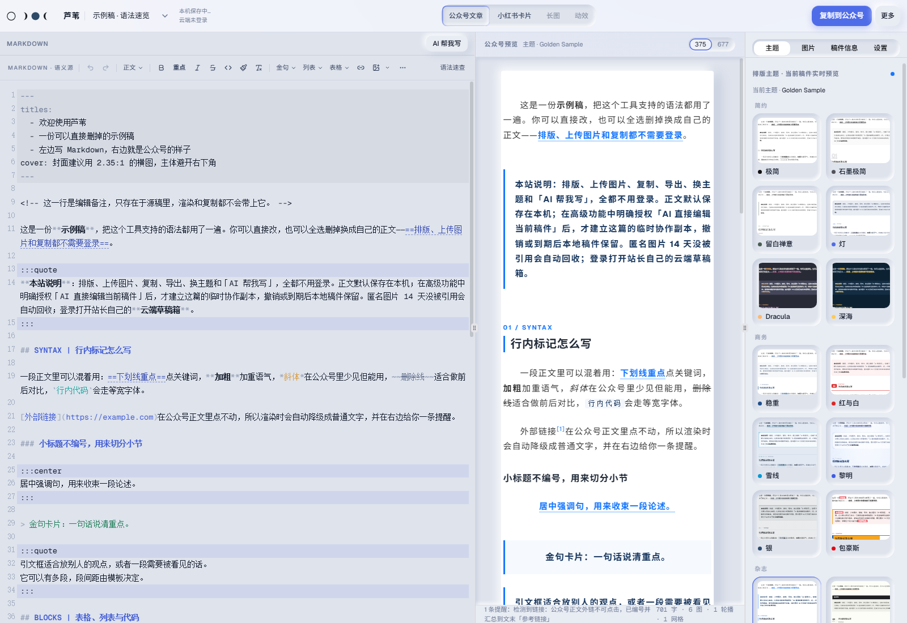
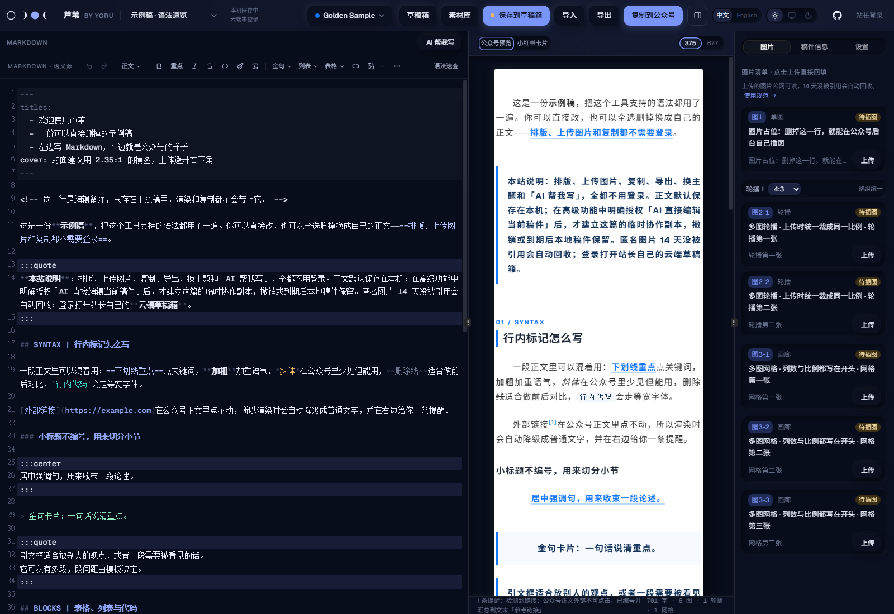
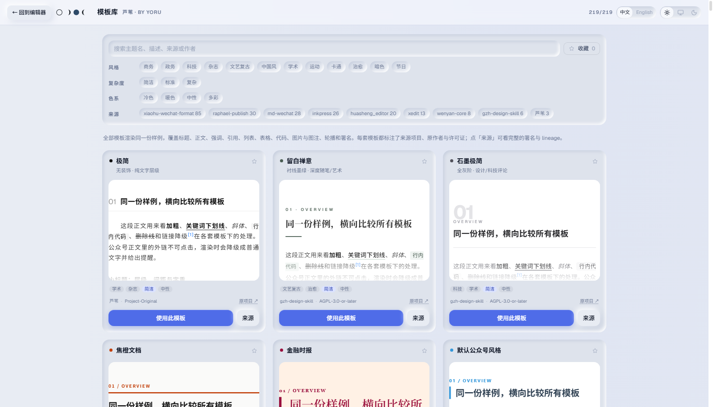
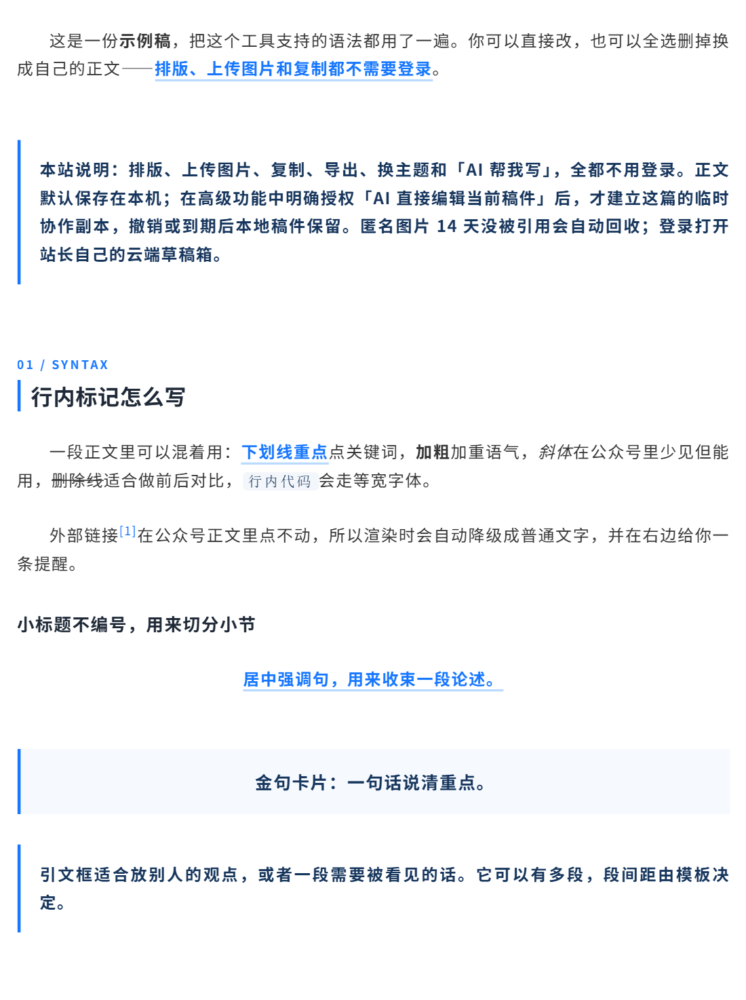

[中文](README.md) | [English](README_EN.md)

# Reed · 芦苇

> “Man is but a reed, the most feeble thing in nature; but he is a thinking reed.”
> — Blaise Pascal, [Pensées, §347](https://www.gutenberg.org/files/18269/18269-h/18269-h.htm#SECTION_VI)

**Turn one Markdown document into a WeChat article, Xiaohongshu image cards or a long-form event recap. Build interactive WeChat stories in the same workspace, too.**

Reed is a free, open-source writing and typesetting tool that runs in your browser. Write your content, choose a format, adjust layouts, fonts and images, then copy it into WeChat or export finished images. Work on your own, use your favorite AI to draft, or connect an agent through MCP to edit the current article directly.

**[Open Reed](https://wechat.yoru-and-akari.dev)** · [Explore WeChat themes](https://wechat.yoru-and-akari.dev/themes) · [AI writing Skill](https://wechat.yoru-and-akari.dev/skill.md)

Built by Yoru and continuously refined through everyday use. The interface supports Chinese and English. You can start editing and exporting without installation or signing in. If you find it useful, a [GitHub Star](https://github.com/yoruuuchan/wechat-md-studio) is appreciated.

| Light interface · akari | Dark interface · yoru |
|:--:|:--:|
|  |  |

## What you can make

| Mode | What you can do | Output |
|---|---|---|
| **WeChat Official Account articles** | Live Markdown typesetting; 227 themes, filtering and side-by-side comparison; cropped images, equations, tables, diagrams, quotes, galleries and carousels | **Paste rich text into WeChat**, or export inline-styled article HTML |
| **Xiaohongshu image cards** | Automatically paginate an article and create its cover; choose built-in and public templates, aspect ratios and backgrounds; preview template thumbnails, customize colors and fonts, import `.reedcard` templates | **1080px PNGs** or a ZIP of the complete set |
| **Long-form event recaps** | Arrange a vertical story from headings, cover photos, sections and photo groups; automatically align consecutive photos in equal-height rows; customize template colors and fonts | **1080 / 1440px JPG or PNG**, split into multiple images when necessary |
| **Interactive WeChat stories** | Visually arrange text, icons, emoji and illustrations, with five scroll, touch, swipe and reveal interaction patterns | **Copy into WeChat** with interactive behavior |

WeChat articles, Xiaohongshu cards and long images share **one Markdown source**; switch modes in the top bar to present it differently. Interactive stories use their own visual composer, integrated into the same editor workspace.

For example, after writing an event recap, you can choose a WeChat theme and paste the result into WeChat; switch to Xiaohongshu cards to paginate it, pick a template and export a set of images; then switch to long-image mode to arrange the event photos into a vertical recap. **It's still one Markdown document**, so you don't have to maintain three versions of the same text.

Try up to three WeChat themes side by side with your own draft. Card and long-image templates also have visual previews, editable colors and fonts, and support for importing your own templates.

## Start in three steps

1. **Bring your content:** [Open Reed](https://wechat.yoru-and-akari.dev), type or paste Markdown, import Markdown / DOCX, or paste rich text from Word or a web page.
2. **Pick a format:** Switch between WeChat articles, Xiaohongshu cards and long images in the top bar. Choose a theme or template, then adjust images, colors and typography. Switch to **Motion** for interactive content.
3. **Copy or export:** Paste WeChat articles into the WeChat editor; download PNG / JPG cards or long images; copy interactive stories into WeChat. Export the source document whenever you need it.

## Create with AI

**Draft with your own AI.** Open **AI 帮我写** (Help me write), copy the prompt or the [writing Skill](skills/wechat-typesetter/SKILL.md) URL, and pass it to ChatGPT, Claude, Codex, OpenCode or another AI. Paste the Markdown it produces back into Reed for editing, styling and image handling. If your AI cannot open links, use the dialog's full-Skill copy action. The writing Skill is currently written in Chinese.

**Make diagrams with your own AI.** Open **AI 画图表** (Diagram with AI) to see sample architecture diagrams, flowcharts and charts. Copy a prompt and the external [diagram-design-zh](https://github.com/patrick-xin/diagram-design-zh) Skill URL (Chinese adaptation by patrick-xin, MIT, based on [Cathryn Lavery's original](https://github.com/cathrynlavery/diagram-design)), then upload the resulting PNG into your article. Reed provides the handoff, not an in-app image-generation model.

**Let an agent edit the current article.** Under **Settings → Advanced → AI directly edits current document**, create a Remote MCP connection. It works without signing in, is authorized per document, and lets the agent read the Skill and draft and write changes back to the browser. Concurrent edits are resolved explicitly. [Remote MCP guide](docs/remote-mcp.md).

An [Agent REST API and Python client](docs/agent-api.md) are also available for the site owner's cloud documents: push a draft, refine it in the browser, then read back the result.

## Editor and typesetting

- **<!-- gen:theme-count -->227 themes<!-- /gen:theme-count -->** with filters for style, complexity, color and source. Favorite templates, trial the current article, or compare up to three candidates side by side. Author, license and provenance are retained.
- **Article-oriented Markdown**: numbered sections, highlights, pull quotes, quotation boxes, centered text, credits, tables, block equations and Mermaid diagrams.
- **Images**: upload, compression (automatic, a 1–5 MB target, or the original file), automatic or manual cropping, a media library, same-ratio carousels and two- to four-column galleries.
- **Editing and preview**: CodeMirror, a Markdown toolbar with per-column and whole-table alignment, semantic format painter, syntax completion, synchronized scrolling and 375 / 677 preview widths. Light, dark and system UI modes.
- **Xiaohongshu cards**: switch to Xiaohongshu cards from the top-bar mode control; templates, ratios and backgrounds live in the sidebar's **Templates** tab. The same Markdown paginates with an automatic cover; the built-in default template supports three aspect ratios and five backgrounds. Export 1080px-wide PNGs or a ZIP; put `---` on its own line for a manual page break. The picker also ships nine public templates everyone can use (Swiss Grid, Editorial White, Book Notes, Aurora, Deep Night, Doc Frame, Tech Pulse, Fresh Notes and Pine Notebook), including visitors. The same tab accepts multiple local `.reedcard` templates at once; after login they sync through the site owner's cloud template library. Sources live in [`card-templates/public/`](card-templates/public/), and public packages pass the exact same parser and safety checks as uploads. See the [template file format](docs/card-template-format.md) and [usage and implementation notes](docs/xhs-cards.md).
- **Long image**: switch to Long image and the same Markdown becomes one tall recap-style image: the first H1 and first image form the header, H2s start sections, consecutive photos keep their proportions in equal-height rows, and whatever follows the last `---` is the closing block. Export a 1080 or 1440px-wide JPG / PNG; an image too tall for the browser is split and says so. Templates are `.reedcard` packages too, so you can upload your own.
- **Motion for articles**: **Motion** in the top bar opens the motion composer in place inside the editor (`/motion/` still opens on its own), a canvas for text, icons, emoji and illustrations where you order what moves after the reader touches a scene. Five ways to play (play on scroll, one step per touch, touch a spot, swipe sideways, tap to grow), and the whole article copies into WeChat. Drafts stay in the browser and can be saved as a file; the site owner also gets cloud drafts after login. See [the notes](docs/motion.md) (Chinese).
- **Storage**: local draft protection, plus the site owner's cloud draft library after login, with synchronization and conflict handling.
- **Import / export**: import Markdown, DOCX and full document backups; rich text pasted from a web page or Word is converted to the article dialect. Export Markdown, article HTML, a complete preview page or a full document backup.
- **Publish check**: before copying an article, exporting article HTML or exporting the full preview page, unfinished equations and diagrams, empty image slots and image URLs on the local machine or a private network are listed as blockers or warnings. A clean article goes straight through.
- **Agent REST API**: a separate API and dependency-free Python client for pushing a draft, opening it for human editing and reading it back. Writes carry the hash from the read, so a stale version is rejected instead of silently overwritten. This interface accesses the site owner's cloud documents, requires an Agent token, and needs browser login for its editor links. See [Agent API](docs/agent-api.md).

Every theme card renders the same sample article, so comparisons show the theme rather than different content. Switch to the current article to trial it, or put up to three candidates side by side; trying and comparing never edit the article or save a theme. Source project, color and license information stay on each card; the author appears under the card's source details.



A closer look at the default `golden` theme, including first-line indentation, numbered headings, highlights, link footnotes, pull quotes and quotation boxes:



## Markdown at a glance

Standard headings, lists, inline formatting, fenced code blocks and GFM tables work alongside these extensions:

| Syntax | Result |
|---|---|
| `==highlight==` | Highlighted words |
| `## KICKER \| Heading` | Automatically numbered section with an optional label |
| `> A memorable line` | Pull-quote card |
| `:::quote` / `:::center` … `:::` | Quotation box / centered emphasis |
| `` | Image with an automatic figure number; an empty URL creates an upload placeholder |
| `` | Existing hosted image reference; public HTTPS image URLs also work |
| `:::carousel 4:3 Title` … `:::` | Same-ratio carousel, default `4:3` |
| `:::gallery 3 1:1 Title` … `:::` | Image grid, default two square columns |
| A standalone `$$ … $$` block | Equation rendered as SVG; inline equations are not supported |
| A fence with language `mermaid` and an optional caption | Diagram rendered to PNG and uploaded |
| `@signature` | Article credits block |
| `<!-- Note -->` | Source-only editorial note; remains literal inside code fences |
| Front matter `titles` / `cover` | Title candidates / cover suggestion, shown only in the side panel |

Use the [sample article](src/lib/sample.ts) and [Skill](skills/wechat-typesetter/SKILL.md) as examples. Image ratios, cropping and WeChat HTML constraints are documented in [Rendering and images](docs/rendering.md). Most technical documentation is currently in Chinese.

## Run locally

Use **Node.js 24**, the currently tested version. Run these commands from the directory containing `package.json` (`app/` in the local umbrella repository):

```bash
npm ci
cp .env.example .env
npm run dev
```

In PowerShell, use `Copy-Item .env.example .env`. Open `http://localhost:3000`. Remove `NODE_ENV` from the development `.env`: setting it to `development` also affects Vite's React production build. See [Configuration](docs/configuration.md) for image hosting, production secrets and startup commands.

| Command | Purpose |
|---|---|
| `npm run check` | TypeScript checks |
| `npm test` | Unit and server tests with Vitest |
| `npm run verify:themes` | Render every theme and check WeChat compatibility |
| `npm run sync:docs` / `npm run verify:sources` | Generate and verify theme statistics in both READMEs, provenance and acknowledgements |
| `npm run build` | Build `dist/boot.js` and `dist/public/` |
| `npm start` | Start production; see Configuration for PowerShell |

The rendering pipeline is `Markdown → semantic AST → Theme → fully inline WeChat-compatible HTML`. React, Vite and CodeMirror handle editing; Hono provides tRPC, REST and MCP. IndexedDB / localStorage hold local drafts, SQLite holds cloud documents and explicitly authorized temporary collaboration copies, and a Worker with R2 hosts images. Preview, copy and article HTML export share the same result.

## Data and publishing boundaries

- **Drafts are local by default.** Enabling Remote MCP uploads a temporary copy of that document, valid for 24 hours by default. Only its visitor and token-bearing clients can access it. Revocation deletes it immediately; expiry blocks access immediately and scheduled cleanup removes it. The local draft remains. The owner's cloud library is a separate login-only feature.
- **Uploaded images are public.** Anyone with an `/api/img/…` URL can view the file. Anonymous uploads have quotas and a default 14-day cleanup period; keeping a reference in a local draft does not guarantee indefinite hosting. Once WeChat has copied an image, the published article uses WeChat's stored version.
- **Authors and publishers are responsible for content.** The service checks file types and quotas, and does not review article or image content. Illegal content, sexual, pornographic or exploitative content involving minors, infringing or privacy-violating content, malware, scams and bulk file-storage abuse are prohibited. Files can be deleted and further uploads refused.

Read the [Terms of use](https://wechat.yoru-and-akari.dev/terms). Rights complaints go through the in-site feedback form ([wechat.yoru-and-akari.dev/feedback](https://wechat.yoru-and-akari.dev/feedback), or the editor sidebar under Settings → Feedback) with the exact URL, evidence of your rights or authorization, and contact details; no receiving address is published on the page — the server forwards the message. The hosted service may change, be limited or go offline; the software is provided without warranty. Self-hosters manage their own storage, domains and terms.

## License and further reading

The application is licensed under **AGPL-3.0-or-later**; see [LICENSE](https://github.com/yoruuuchan/wechat-md-studio/blob/master/LICENSE).

<!-- BEGIN GENERATED: readme-theme-sources — npm run sync:docs -->
The library contains **227 themes**: 3 originals and 224 adapted from 9 upstream projects. Authors, licenses and provenance are recorded in shared metadata.

See [THEME-SOURCES](THEME-SOURCES.md) for the audit. Project acknowledgements and adaptation notes come from [credits.ts](src/lib/credits.ts) and appear in [References](https://wechat.yoru-and-akari.dev/references) and [LICENSES/NOTICE](LICENSES/NOTICE.md).
<!-- END GENERATED: readme-theme-sources -->

| Document | Covers |
|---|---|
| [AGENTS.md](AGENTS.md) | Contributor entry point and engineering rules |
| [AI writing / Remote MCP](docs/remote-mcp.md) / [Skill](skills/wechat-typesetter/SKILL.md) | Writing instructions and single-document collaboration |
| [Documents and editor](docs/documents.md) | Storage, synchronization, conflicts and backups |
| [Rendering and images](docs/rendering.md) | Markdown, themes, WeChat HTML and image lifecycle |
| [Xiaohongshu cards](docs/xhs-cards.md) / [Template file format](docs/card-template-format.md) | Pagination, templates, ratios, export and uploaded template format |
| [Long image](docs/long-image.md) | Markdown mapping, photo groups, long-image templates, export and splitting |
| [Agent API](docs/agent-api.md) | REST / Python push-and-read-back workflow |
| [Configuration](docs/configuration.md) / [Verification](docs/verification.md) / [HANDOFF](HANDOFF.md) | Development, checks and deployment |
| [Brand and compatibility](docs/branding.md) | Naming and retained internal identifiers |

Reed's Chinese name is **芦苇**. The repository name `wechat-md-studio` and existing domains stay unchanged.
