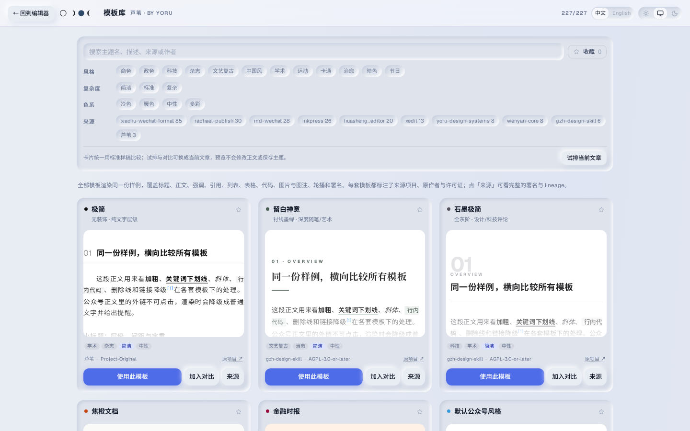
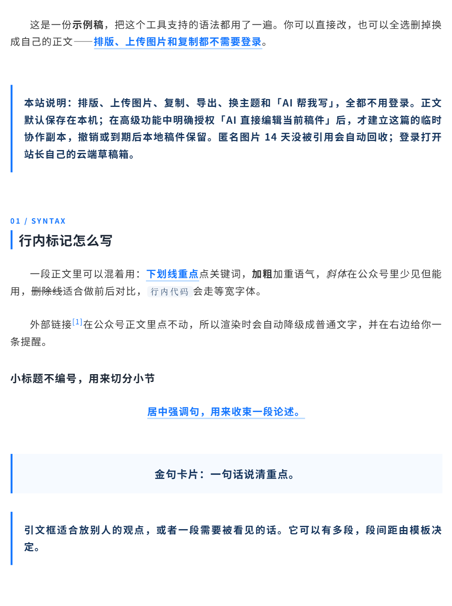

# 功能清单

[返回项目首页](../README.md) · [English](features_EN.md)

芦苇各模式的完整功能。主题数量、来源与许可的统计见 [README 的「License 与来源」](../README.md#license-与来源)。

- **公众号主题库**：按风格、复杂度、色系与来源筛选，收藏常用模板，用同一份样稿比较效果；保留作者、License 与移植来源。
- **公众号 Markdown 方言**：章节自动编号、重点标记、金句卡、引文框、居中句、署名、表格、公式和 Mermaid 图表。
- **图片**：上传、压缩（自动 / 指定 1–5 MB / 原图）、自动 / 手动真实裁切、素材管理；同比例轮播与 2～4 列网格。
- **编辑与预览**：CodeMirror、Markdown 工具栏（含表格按列 / 整表对齐）、语义格式刷、语法补全、同步滚动、375 / 677 预览；界面支持浅色 / 深色 / 跟随系统。
- **小红书卡片**：从顶栏的模式入口切到「小红书卡片」，模板、比例和背景在右栏「模板」里调整；一份 Markdown 自动分页并生成封面，内置默认模板支持三种比例、五种背景，导出 1080px 宽 PNG 或整套 ZIP；单独一行 `---` 可手动换页。模板选择里另有 9 套人人可用的公用模板（瑞士秩序、纸页杂志、书页摘录、柔光极光、夜间研究、文档结构、科技脉冲、清爽手帐、雾松笔记），访客也能直接使用；同一栏还可以一次上传多个本机 `.reedcard` 模板文件，登录后与站长的云端模板库同步，删除也会跨设备生效。源文件在 [`card-templates/public/`](../card-templates/public/)，公用包与上传包走完全相同的解析和安全检查。格式与限制见 [模板文件格式](card-template-format.md)，[使用与实现说明](xhs-cards.md)。
- **长图**：从模式入口切到「长图」，同一份 Markdown 排成一张活动回顾式的竖长图：一级标题和第一张图是头部，二级标题分小节，连着放的照片按原比例等高成行，最后一个 `---` 之后是落款。导出 1080 或 1440 宽的 JPG / PNG，太长时明说分成几张；模板同样是 `.reedcard`，可以上传自己的。
- **推文动效**：顶栏的「动效」在编辑器里原地打开推文动效搭建台（`/motion/` 仍可单独打开），在画布上摆文字、图标、表情和插画，排好读者碰一下之后谁先动，五种玩法（滑过就演、一滑一步、点哪动哪、左右滑、点一下长出来），整篇复制进公众号；稿子存在浏览器里，可以存成文件带走，站长登录后另有云端草稿箱。[说明](motion.md)。
- **保存**：本机防丢，登录后使用站长的云端草稿箱；本机与云端同步同样有冲突处理。
- **导入导出**：Markdown、DOCX 与整包备份导入，粘贴网页 / Word 富文本会自动转成公众号方言；Markdown、正文 HTML、完整预览页与整包稿件备份导出。
- **发布前检查**：整篇复制、正文 HTML 与完整预览页导出之前，先列出未完成的公式与图表、空图片位、本机或内网的图片地址，按阻断 / 提醒分级；干净的稿件直接通过。
- **Agent REST API**：保留独立的 REST API 和零依赖 Python 客户端，支持推稿 → 网页精修 → 读回结果，使用 hash 防止静默覆盖。它访问站长的云端稿件，需要单独配置 Agent 令牌，打开编辑链接需要浏览器登录；接入见 [Agent API](agent-api.md)。

模板库中的卡片都渲染同一份样稿，方便横向比较；也可以切到当前文章试排，把最多 3 套候选并排比较。试排和对比都不会改正文或保存主题，只有明确的「应用」才写入；来源项目、色系与许可证直接列在卡片上，作者点开「来源」查看。

默认 `golden` 主题的正文特写：首行缩进、章节编号、重点、链接脚注、金句卡和引文框。

