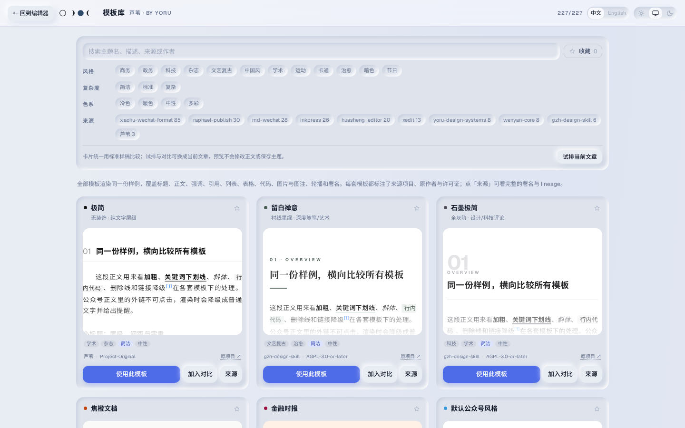
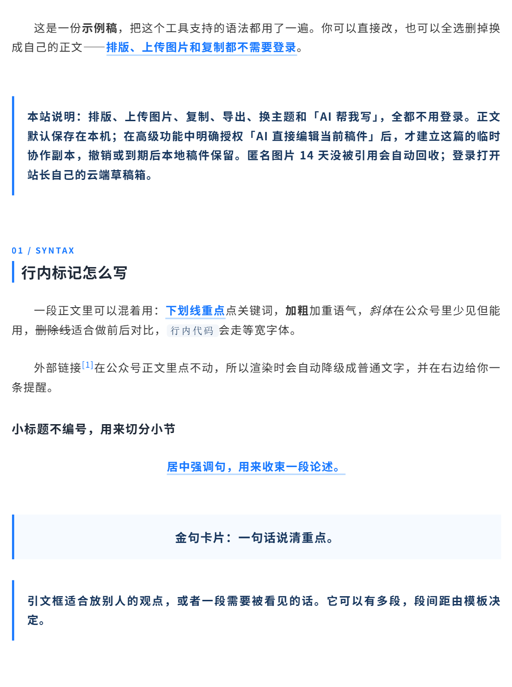

# Feature list

[Back to the README](../README_EN.md) · [中文](features.md)

Everything Reed can do, mode by mode. Theme counts, provenance and licenses are summarized in the [README under "License and sources"](../README_EN.md#license-and-sources).

- **WeChat theme library** with filters for style, complexity, color and source. Favorite templates, trial the current article, or compare up to three candidates side by side. Author, license and provenance are retained.
- **Article-oriented Markdown**: numbered sections, highlights, pull quotes, quotation boxes, centered text, credits, tables, block equations and Mermaid diagrams.
- **Images**: upload, compression (automatic, a 1–5 MB target, or the original file), automatic or manual cropping, a media library, same-ratio carousels and two- to four-column galleries.
- **Editing and preview**: CodeMirror, a Markdown toolbar with per-column and whole-table alignment, semantic format painter, syntax completion, synchronized scrolling and 375 / 677 preview widths. Light, dark and system UI modes.
- **Xiaohongshu cards**: switch to Xiaohongshu cards from the top-bar mode control; templates, ratios and backgrounds live in the sidebar's **Templates** tab. The same Markdown paginates with an automatic cover; the built-in default template supports three aspect ratios and five backgrounds. Export 1080px-wide PNGs or a ZIP; put `---` on its own line for a manual page break. The picker also ships nine public templates everyone can use (Swiss Grid, Editorial White, Book Notes, Aurora, Deep Night, Doc Frame, Tech Pulse, Fresh Notes and Pine Notebook), including visitors. The same tab accepts multiple local `.reedcard` templates at once; after login they sync through the site owner's cloud template library. Sources live in [`card-templates/public/`](../card-templates/public/), and public packages pass the exact same parser and safety checks as uploads. See the [template file format](card-template-format.md) and [usage and implementation notes](xhs-cards.md).
- **Long image**: switch to Long image and the same Markdown becomes one tall recap-style image: the first H1 and first image form the header, H2s start sections, consecutive photos keep their proportions in equal-height rows, and whatever follows the last `---` is the closing block. Export a 1080 or 1440px-wide JPG / PNG; an image too tall for the browser is split and says so. Templates are `.reedcard` packages too, so you can upload your own.
- **Motion for articles**: **Motion** in the top bar opens the motion composer in place inside the editor (`/motion/` still opens on its own), a canvas for text, icons, emoji and illustrations where you order what moves after the reader touches a scene. Five ways to play (play on scroll, one step per touch, touch a spot, swipe sideways, tap to grow), and the whole article copies into WeChat. Drafts stay in the browser and can be saved as a file; the site owner also gets cloud drafts after login. See [the notes](motion.md) (Chinese).
- **Storage**: local draft protection, plus the site owner's cloud draft library after login, with synchronization and conflict handling.
- **Import / export**: import Markdown, DOCX and full document backups; rich text pasted from a web page or Word is converted to the article dialect. Export Markdown, article HTML, a complete preview page or a full document backup.
- **Publish check**: before copying an article, exporting article HTML or exporting the full preview page, unfinished equations and diagrams, empty image slots and image URLs on the local machine or a private network are listed as blockers or warnings. A clean article goes straight through.
- **Agent REST API**: a separate API and dependency-free Python client for pushing a draft, opening it for human editing and reading it back. Writes carry the hash from the read, so a stale version is rejected instead of silently overwritten. This interface accesses the site owner's cloud documents, requires an Agent token, and needs browser login for its editor links. See [Agent API](agent-api.md).

Every theme card renders the same sample article, so comparisons show the theme rather than different content. Switch to the current article to trial it, or put up to three candidates side by side; trying and comparing never edit the article or save a theme. Source project, color and license information stay on each card; the author appears under the card's source details.

A closer look at the default `golden` theme, including first-line indentation, numbered headings, highlights, link footnotes, pull quotes and quotation boxes:

