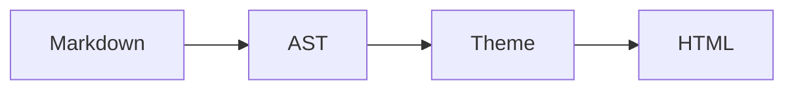

# 微信渲染与图片链路

[项目首页与语法表](../README.md) · [Agent 入口](../AGENTS.md) · [验证导航](verification.md)

本文说明实现和取舍；可执行规则来自 [types.ts](../src/lib/types.ts)、[parse.ts](../src/lib/parse.ts)、
[render.ts](../src/lib/render.ts)、[theme-kit.ts](../src/lib/theme-kit.ts)、相关测试与
[verify-themes.ts](../scripts/verify-themes.ts)。

## 渲染边界

`Markdown → 语义 AST → Theme → 微信兼容的全内联 HTML`。
parser 只产出语义节点和全稿源位置，不为某套主题做视觉判断；Theme 提供组件模板，
`renderDoc` 统一编号、收集外链、插入盒式模块空行，并返回 HTML、统计和块偏移。
预览、富文本复制和干净正文导出消费同一份 HTML，主题变化不改源稿。

`golden` 最初以「公众号排版示范稿_GoldenSample_修正版.html」为设计基线；该稿如另行提供，按提供版本核对。
仓库内可复现的样稿与规则以 [sample.ts](../src/lib/sample.ts) 和 `verify:themes` 输出为准。

公式、图片和 Mermaid 的异步工作在编辑器编排层完成，通过 `resolveImg` / `resolveMath` /
`resolveDiagram` 注入缓存结果，保持 `renderDoc` 同步、可在 Node 中运行。
导出的完整预览页另有按钮和外壳；微信兼容规则检查的是其中的正文根节点。

## 主题库试排与对比

主题库卡片统一渲染 `THEME_PREVIEW_DOC`；「试排当前文章」与 1–3 套候选对比只复用编辑器同一条
`parseMarkdown → renderDoc` 链路，并注入同一 `resolveImgSrc`、MathJax 快照和 Mermaid 缓存，
所以试排 HTML 与编辑器最终预览一致（浏览器脚本逐字节核对）。试排只读取本机当前稿：
正文未加载 / 读取失败 / 云端 stub / 本机缺失分别给出原因并回退标准样稿，不把占位当空稿，
也不为预览拉取云端正文。候选最多 3 套，只有明确的「应用此主题」会写 `themeId`；筛选与滚动
只在本次页面会话内保留，返回主题库时恢复，整页刷新从干净筛选开始。

设计系统来源的三套手写主题（`yoru-type` 铅字房、`paper-editorial` 纸本、`console-akari` 灯）与导入主题走同一个 `Theme` 接口；它们的结构、元素落点与上游差异见[设计系统模板](design-templates.md#公众号主题)。纸本需要知道「是不是首段」才能做首行缩进，因此 `Theme.paragraph` 多了一个可选的 `{ first }` 上下文；旧主题不读它，输出不变。

## 正文兼容规则

| 边界 | 当前规则与检查入口 |
|---|---|
| 结构 | 唯一顶层 `<section>`，允许嵌套；正文不带 `class` / `id` / `<script>` / `<style>` / `<div>` |
| 文字 | 正文文字包在 `<span leaf="">`；代码块保留缩进并使用 `white-space:pre-wrap` |
| 样式 | 全内联；禁 `position:fixed/absolute/sticky`、`float`、`display:grid`、`@media`、`@keyframes`；导入样式由 `sanitizeStyle` 清理 |
| 根容器 | 只写不改变横向几何的声明：宽度用 `max-width` 表达，不写左右 `padding`、固定宽度或百分比缩进 |
| 盒式模块 | renderer 插入独立空行 `<p style="margin:0;"><span leaf="">&nbsp;</span></p>`，合并连续空行 |
| 图片 | 空 `src` 生成普通 `图N 说明` 占位段落；单图、轮播、网格都解析 `img:<key>` |
| 表格 | 真 `<table>`，单元格保留边框、leaf 文字与逐列对齐 |
| 多图 | 比例由真实裁切保证；图片保留确定宽高属性及 `height:auto`，不用 `object-fit` 或固定图片高度伪造 |
| 公式 | SVG 另由 [math-sanitize.ts](../src/lib/math-sanitize.ts) 与 [测试](../src/lib/math-sanitize.test.ts) 检查，不把 MathJax 原始输出直接插进正文 |

完整断言以 `verify:themes` 和相邻测试为准，不在其他文档另建规则副本。

CommonMark 列表会保留两层、三层及更深层级的嵌套，以及有序 / 无序混合、同一条目内的多段文字
和有序列表起始序号。单层列表继续使用各主题自己的 `listBlock` 样式；出现嵌套时，
共用一套语义 `ul` / `ol` / `li` 树渲染，避免逐个修改 227 套主题，也不会把子列表拉平。

根容器为什么不能用左右内边距或参与布局的边框：微信编辑器会在编辑时**复制或合并外层的 `<section>`**——2026-10-27 在一篇真实草稿里数到同一份 golden 根样式存在 11 份、最深嵌套 3 层，每多一层正文就窄 20px（578 → 558 → 538 → 518），表现就是「正文往下越过某一段之后莫名往里缩」。`max-width` 这类上限是幂等的（657 套在 657 里仍是 657），像素内边距不是。因此横向留白统一折进 `max-width`（上限＝677px 减左右留白），根边框改为不占布局宽度的内嵌 outline，窄屏时正文自然铺满微信给的内容区。
2026-10-28 在测试号按最坏情况复验：把整篇粘进自己的末尾，块数 16→32、轮播 / 表格 / 代码各变两份，整宽块的边缘仍是同一组、`padding:0 10px` 残留为 0——657 根被复制嵌套时也不会叠出内边距。

`html:false` 禁止 Markdown 原样 HTML；[comments.ts](../src/lib/comments.ts) 把编辑备注等长空格化，
保留行号与字符偏移，围栏代码中的注释仍显示。图片 occurrence 扫描与回填必须对称跳过围栏 / 注释，
否则重复图注会填错图片。对应 [comments.test.ts](../src/lib/comments.test.ts)、
[fences.test.ts](../src/lib/fences.test.ts)、[render.image-ops.test.ts](../src/lib/render.image-ops.test.ts)。

非空且非 `#fragment` 的链接当前都转成编号脚注，文末按 URL 去重；详细行为以
[footnotes.test.ts](../src/lib/footnotes.test.ts) 为准。front matter 的 `titles` / `cover` 只供侧栏，
支持简单键值与标题列表，完整示例在 [sample.ts](../src/lib/sample.ts)。

## 公式

`$$…$$` 独占一段生成块级公式，可单行或多行；当前 parser 不解析行内 `$…$`。
[math.ts](../src/lib/math.ts) 按需加载固定版本的 `mathjax-full` v3，使用 `liteAdaptor` 与
`fontCache:'none'`，让 SVG 自带 path，不依赖共享字体缓存或外部 CSS。
TeX 包白名单、MathJax Safe 与序列化 SVG 消毒共同限制可进入正文的内容。

加载时显示 TeX 占位，编译 / 消毒失败时显示「公式无法编译」与源码，并留下诊断；
不把 MathJax 的红色错误盒子当作公式复制。结果按 TeX 与 display 状态缓存。

复制与两份 HTML 导出共用 [math.ts](../src/lib/math.ts) 的就绪状态，正文按当前稿件即时重渲染：
公式还在渲染时提示等待，不交付 TeX 占位；编译失败时说明是哪个公式，改好即可恢复，也可以由作者明确选择按源稿继续；
MathJax 组件本身加载失败会单独说明并可重试。Markdown 与整包备份始终导出源稿，切稿后状态按当前稿件重算。
2026-10-29 用 [浏览器脚本](../scripts/cdp-verify-math-readiness.mjs) 在限速、断网、坏公式与 Mermaid 并存下复验。
2026-10-07 的微信实粘记录支持保留 `ex` 尺寸与 `currentColor`，只在 wrapper 明确颜色，
不手算 `ex → px`；对应 [math.test.ts](../src/lib/math.test.ts) 与 [浏览器脚本](../scripts/cdp-verify-math.mjs)。

## Mermaid

````md

````

停手约 1.2 秒后：[diagram-raster.ts](../src/lib/diagram-raster.ts) 按需加载 Mermaid，
`SVG → canvas → PNG → storage.upload → img:<key>`，正文最终渲染普通 ``，参与图号和素材统计。
当前匿名访客也走上传链路，受匿名额度约束；语法 / 上传失败会提示原因并在正文保留源码。
复制时若图表仍在处理，编辑器会提示等待。

选择 PNG 是为了保持纯字符串渲染链与统一图片管线。上游 SVG 常带 style、class、id、foreignObject；
完整 SVG 适配还依赖活 DOM 的 `getBBox` / `getComputedStyle`，相关方案比较保留在
[credits.ts](../src/lib/credits.ts) 的 doocs/md 条目。
代价是图中文字不可选、图片颜色不随主题变化、改源码需重新生成并上传。

源码始终留在 Markdown；PNG 是按源码键缓存的派生结果。
[diagram.ts](../src/lib/diagram.ts) 将映射保存在 `mopai.diagrams.v1`，最多 50 条；换设备会重新生成。
逻辑与真实链路分别见 [diagram.test.ts](../src/lib/diagram.test.ts)、
[diagram-raster.test.ts](../src/lib/diagram-raster.test.ts)、[cdp-verify-diagram.mjs](../scripts/cdp-verify-diagram.mjs)。

## 图片上传、定位与生命周期

```text
拖拽 / 粘贴 / 侧栏上传 → 浏览器真实裁切与压缩
→ tRPC storage.upload → 图片 Worker → R2
→ Markdown 回填 img:<key>
→ resolveImg 展开成 <当前 origin>/api/img/<key>
→ 站点 302 → Worker 公网图片 → 微信自行转存
```

裁切在 [image.ts](../src/lib/image.ts)，压缩在 [image-compress.ts](../src/lib/image-compress.ts)：
默认最长边 2048、目标 800 KiB、quality 从 0.9 按 0.1 降到 0.6；不放大小图，重编码增大时优先原文件。
这是编码目标，不替代服务端的 20 MiB 上限与 JPEG / PNG / GIF / WebP 字节头检查。
具体入口的裁切 / 压缩组合见 [EditorPage.tsx](../src/pages/EditorPage.tsx)。

普通单图上传前可以选「上传大小」（自动 / 1–5 MB / 原图），选择记在本机设置里、下次沿用。
自动＝上面的默认预算；1 MB 沿用 2048 像素预算、只放宽字节上限；2–5 MB 每档把长边预算加 512 像素（封顶 4096）并同步放宽字节上限——
只放宽字节的话，2048 像素下多数照片到不了 2 MB，大档位会形同虚设。字节目标只是上限：更小的图不放大、不补足，超预算时才沿质量阶梯降。
原图＝跳过压缩、原文件直传；超过单图 20 MiB 上限（contracts/constants.ts，客户端与两扇服务端共用同一常量）的文件在弹窗里直接拦下并提示换档，不会传到服务端才失败。
轮播 / 网格与手裁结果不经过这一档，保持既有裁切链路，不做第二次有损压缩。

回填 / 清空 / 删除图片时，源稿按 parser 接受的图片语法定位整段 ``：
源里的平衡括号（`a(b).png`）、转义括号、`<…>` 目标与 `"…"` / `'…'` / `(…)` 标题都整段处理，
不再按第一个 `)` 截断而留下 `.png)`；围栏代码与编辑备注里的示例照旧跳过，语法不完整时操作返回原文并提示定位失败。
对应 [render.image-ops.test.ts](../src/lib/render.image-ops.test.ts)。

复制的 HTML 必须包含绝对公网图片 URL，`/api/img/*` 要能匿名读取。
短 key 稳定不等于图片永久保留：匿名图可能在默认 14 天后因没有云端引用被回收，
详见 [HANDOFF](../HANDOFF.md#安全与匿名资源回收)。站长图不属于匿名 GC 范围。
已经被微信转存的文章图片不受本站删图影响。

转存结果可以直接验（2026-10-28 测试号实测）：图片会变成
``——
我们写的内联样式与 `width` / `height` 属性都还在，没有被换成微信的默认值。
编辑器另在每张图旁插一个无 `src` 的 ``，所以在微信正文的 DOM 里按 `img` 计数会得到模型的两倍，要按 `src` 或 `data-imgfileid` 过滤。
反过来，src 微信服务器抓不到时不会裂图，而是被加 `display:none` 直接隐形：同一轮用 `http://127.0.0.1:…` 做图源，转存失败后正文看起来就是「少了图」。
所以复制前要确认图床公网可达——本机与内网地址一定不可达，自托管场景尤其容易踩。

## 轮播与网格

`:::carousel [比例] 标题` 默认 `4:3`；支持 `4:3`、`3:4`、`16:9`、`9:16`、`1:1`。
冒号后带空格的 `::: carousel` 也按轮播解析；开栏可用 3 个以上冒号，闭栏冒号不少于开栏且其后只能是空格，不写闭栏时在文末自动结束。
`:::carousel-open` / `:::carousel-close` 不是容器语法，只会当普通段落，侧栏比例按解析出的轮播编号定位，代码块、编辑备注和 front matter 里的示例不占编号。
第一张上传时选择比例，同组后续图片沿用；自动居中或手动裁切都发生在上传前。
改比例不重新生成旧图，需重传 / 重裁；裁掉的部分不在图床保留，需要原图。
重裁时，轮播与网格图片会继承所在组已经声明的比例并锁定裁切框；单图仍可自由决定比例。
上传结果的真实像素尺寸、浏览裁切框和 fence 参数三者保持一致。

滑动条由 [carouselStrip](../src/lib/theme-kit.ts) 统一生成（手写主题与导入主题共用同一结构）：
格子取容器的百分比宽度（`88%` + `2%` 间隙，下一张露出一角是滑动线索），图片 `width:100%;height:auto`，
比例只落在 `width`/`height` 属性上——**滑动条内不写任何固定像素宽度**。
微信编辑器粘贴时的「内容结构检测」会对**任何横向滚动结构**提示「存在特殊排版…溢出问题」（#1.4 width）：
2026-10-13 的二分实测确认该提示与 px/％ 无关（旧 px 结构与新百分比结构触发行完全相同，去掉滚动即消失），
点「继续插入」即可入正文；百分比结构消除的是固定像素宽在窄屏下的溢出隐患，属渲染稳定性修复，不是该提示的解药。
占位框同样改用百分比内边距撑出画框比例。
还没上传图片的轮播 / 网格（`` 占位，没有 ``）粘进公众号后，那条滑动条会退化成普通块：2026-10-28 用全空图样例实测，轮播 + 网格两条 strip 只剩一条。要验滑动效果，先在侧栏把图片传上去再复制。
`scripts/cdp-verify-carousel-copy.mjs` 与 `verify:themes`（全主题零 px 宽度断言）钉住结构与抓图契约；
提示的完整实测记录见 [HANDOFF](../HANDOFF.md) 2026-10-13 条目。

```md
:::gallery 3 4:3 现场花絮


:::
```

网格列数支持 `2` / `3` / `4`，默认两列正方形。裸整数识别为列数，带冒号识别为比例，
所以 `:::gallery 4:3 标题` 表示默认两列 + 4:3；不支持的值保留在标题中。
轮播左右滑动，网格同时展示；网格用百分比 `inline-block` 格子，向下取整保证一行不超过 100%。
网格比例写在 fence 中，上传界面按它锁定；侧栏比例选择器只修改轮播。

行齐依赖图片自身已裁到同比例。宽高属性只占位，手写外链或 Agent API 上传不会替图片裁切，
不同比例仍会保留自己的形状；单靠标记不能补齐。对应 [gallery.test.ts](../src/lib/gallery.test.ts)、
`verify:themes` 与 [cdp-verify-gallery.mjs](../scripts/cdp-verify-gallery.mjs)。

## 字体与来源

UI 的 Geist / Geist Mono 与 Noto Sans SC 自托管于 [public/fonts/](../public/fonts/)，
Noto 字体按 `unicode-range` 切片，只下载当页所需字符；SIL OFL 许可副本见
[OFL-Geist.txt](../public/fonts/OFL-Geist.txt) 与 [OFL-NotoSansSC.txt](../public/fonts/OFL-NotoSansSC.txt)。
正文使用各 Theme 的字体栈，微信读者端受系统字体限制；预览 CSS 或字体文件存在不能证明微信端能用该字体。
当前 `zen` 的 Noto Serif SC 700 由 [fonts-local.css](../public/fonts/fonts-local.css) 和本地 woff2 提供预览字体；
复制进微信的正文仍靠读者端字体栈，不能把本站预览字体视作微信端保证。

八套设计系统主题（`yoru-type` / `paper-editorial` / `console-akari` / `kunlun-snowline` / `rift-daybreak` / `core-frost` / `aozora-daylight` / `kihon-gin`）遵循同一条边界：正文不加载网页字体。除了 core 霜纸的正文写明系统衬线栈（Songti SC / STSong / SimSun），其余七套的正文不写 `font-family`，完全使用读者手机的系统字体；core 同样不把未加载的 Tinos 或只有 700 的 Noto Serif SC 放进正文。标题、图注、代码等位置才写字体栈，缺字体时按栈回落到宋体/黑体/等宽。上游的思源、Geist、EB Garamond、Instrument Sans、B612 Mono 等自托管字体不会随正文进入公众号，预览里看到的字形不等于微信端字形。

小红书卡片模板另带一组自托管字体，`@font-face` 统一在
[fonts-templates.css](../public/fonts/fonts-templates.css) 与
[fonts-design.css](../public/fonts/fonts-design.css)：Fontsource 5.3.x 的
Noto Serif SC 400（101 个中文切片）、Inter 400/600、JetBrains Mono 400/700、
EB Garamond 400/400 italic/600、IBM Plex Sans 400/500、IBM Plex Mono 400、Caveat 400，
以及第二批的 Instrument Sans 400/500/700、B612 Mono 400/700、Orbitron 500/700/900、
VT323 400、Space Grotesk 300–700、Bebas Neue 400、Chakra Petch 500/700、
DM Serif Display 400 italic、Rajdhani 400–700、Share Tech Mono 400、
Pixelify Sans 400–700、Tinos 400/700 + italic、Press Start 2P 400、
DotGothic16 400（124 个日文切片）、Major Mono Display 400。拉丁族只取 `latin` 子集；
第二批新增的 157 个 woff2 合计约 1.20 MB。模板名和字标移除后，Bebas Neue、
Chakra Petch、Press Start 2P、DotGothic16、Major Mono Display 仍随字体包保留，
只是不再由 `CARD_TEMPLATE_FONTS` 预载或内嵌。
朱雀仿宋 400 来自官方仓库 [TrionesType/zhuque](https://github.com/TrionesType/zhuque)
v0.212 的 `ZhuqueFangsong-Regular.ttf`，由
[slice-by-ranges.py](../scripts/fonts/slice-by-ranges.py) 按 Noto Serif SC 700 的
unicode-range 逐片裁成 99 个 woff2（没有字形的片跳过），CSS 在
[zhuque-fangsong.css](../public/fonts/zhuque-fangsong.css)。许可副本：
[OFL-NotoSerifSC.txt](../public/fonts/OFL-NotoSerifSC.txt)、
[OFL-Inter.txt](../public/fonts/OFL-Inter.txt)、
[OFL-JetBrainsMono.txt](../public/fonts/OFL-JetBrainsMono.txt)、
[OFL-EBGaramond.txt](../public/fonts/OFL-EBGaramond.txt)、
[OFL-IBMPlexSans.txt](../public/fonts/OFL-IBMPlexSans.txt)、
[OFL-IBMPlexMono.txt](../public/fonts/OFL-IBMPlexMono.txt)、
[OFL-Caveat.txt](../public/fonts/OFL-Caveat.txt)、
[OFL-ZhuqueFangsong.txt](../public/fonts/OFL-ZhuqueFangsong.txt)、
[OFL-InstrumentSans.txt](../public/fonts/OFL-InstrumentSans.txt)、
[OFL-B612Mono.txt](../public/fonts/OFL-B612Mono.txt)、
[OFL-Orbitron.txt](../public/fonts/OFL-Orbitron.txt)、
[OFL-VT323.txt](../public/fonts/OFL-VT323.txt)、
[OFL-SpaceGrotesk.txt](../public/fonts/OFL-SpaceGrotesk.txt)、
[OFL-BebasNeue.txt](../public/fonts/OFL-BebasNeue.txt)、
[OFL-ChakraPetch.txt](../public/fonts/OFL-ChakraPetch.txt)、
[OFL-DMSerifDisplay.txt](../public/fonts/OFL-DMSerifDisplay.txt)、
[OFL-Rajdhani.txt](../public/fonts/OFL-Rajdhani.txt)、
[OFL-ShareTechMono.txt](../public/fonts/OFL-ShareTechMono.txt)、
[OFL-PixelifySans.txt](../public/fonts/OFL-PixelifySans.txt)、
[OFL-Tinos.txt](../public/fonts/OFL-Tinos.txt)、
[OFL-PressStart2P.txt](../public/fonts/OFL-PressStart2P.txt)、
[OFL-DotGothic16.txt](../public/fonts/OFL-DotGothic16.txt)、
[OFL-MajorMonoDisplay.txt](../public/fonts/OFL-MajorMonoDisplay.txt)。
卡片分页预载与 PNG 内嵌都读 [cards.ts](../src/lib/cards.ts) 的 `CARD_TEMPLATE_FONTS`，
两处不会各写一份字体白名单。

模板右栏「字体」菜单另有六款可选中文字体，同样用
[slice-by-ranges.py](../scripts/fonts/slice-by-ranges.py) 按 Noto Serif SC 700 的 unicode-range
裁成 woff2（`--no-hinting`，去掉 TrueType 微调指令，合计约 25 MB，按需只下载用到的片）：
霞鹜文楷 LXGW WenKai 1.522（101 片，[lxgw-wenkai.css](../public/fonts/lxgw-wenkai.css)）、
得意黑 Smiley Sans 2.0.1（100 片）、站酷小薇体 ZCOOL XiaoWei 1.000（93 片）、
站酷庆科黄油体 ZCOOL QingKe HuangYou 1.000（93 片）、站酷快乐体 ZCOOL KuaiLe 2.001（94 片）、
马善政楷书 Ma Shan Zheng 2.003（93 片），CSS 分别在 `public/fonts/` 下同名文件。
这六款不进全局样式表，读者选中时才由 [font-catalog.ts](../src/lib/font-catalog.ts) 的
`ensureFontSheets` 插入 `<link>`；朱雀仿宋也改由它在预览里按需加载（此前只在导出时内嵌，预览靠回落）。
许可副本（版权行取自各字体 name 表，正文为 SIL OFL 1.1）：
[OFL-LXGWWenKai.txt](../public/fonts/OFL-LXGWWenKai.txt)、
[OFL-SmileySans.txt](../public/fonts/OFL-SmileySans.txt)、
[OFL-ZCOOLXiaoWei.txt](../public/fonts/OFL-ZCOOLXiaoWei.txt)、
[OFL-ZCOOLQingKeHuangYou.txt](../public/fonts/OFL-ZCOOLQingKeHuangYou.txt)、
[OFL-ZCOOLKuaiLe.txt](../public/fonts/OFL-ZCOOLKuaiLe.txt)、
[OFL-MaShanZheng.txt](../public/fonts/OFL-MaShanZheng.txt)。

读者自己添加的字体文件只存在浏览器 IndexedDB，不经过服务器。导出 PNG 时，`.ttf` / `.otf`
由 [font-subset.ts](../src/lib/font-subset.ts) 调用 harfbuzzjs 1.6.4 的 `harfbuzz-subset.wasm`
裁成只含这张图用到的字再以 data URL 内嵌（25 MB 的文楷裁一段中文约 6 KB）；`.woff` / `.woff2` 整个内嵌。
WebAssembly 需要 CSP 的 `script-src 'wasm-unsafe-eval'`，它只放行 wasm 编译，JavaScript 的 `eval` 仍被禁止
（[security-headers.ts](../api/lib/security-headers.ts)）。

主题移植损耗与许可审计见 [THEME-SOURCES](../THEME-SOURCES.md)；借鉴与未采用的机制见
[References](https://wechat.yoru-and-akari.dev/references) / [credits 数据](../src/lib/credits.ts)。
